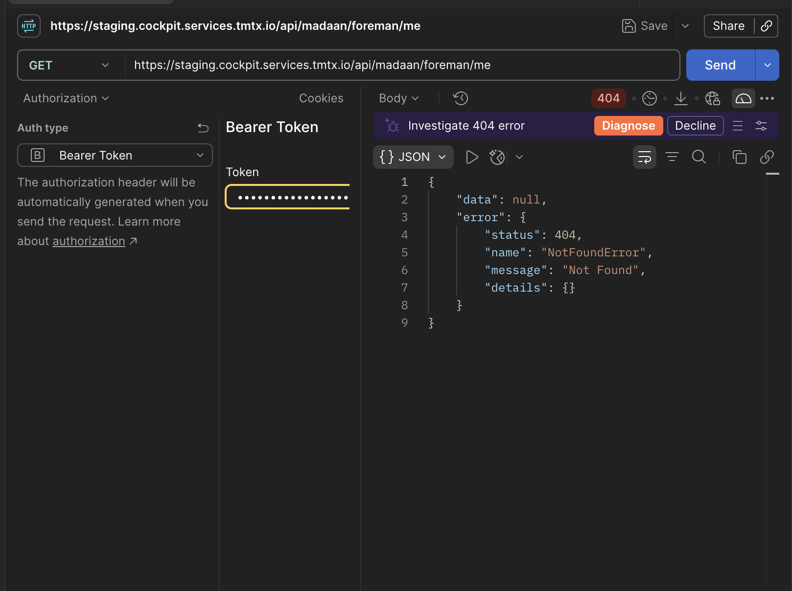
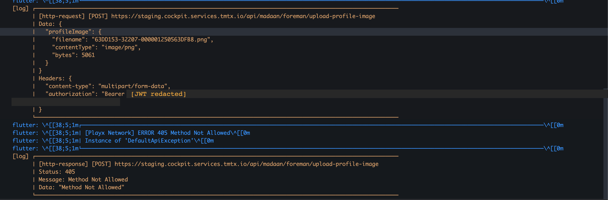
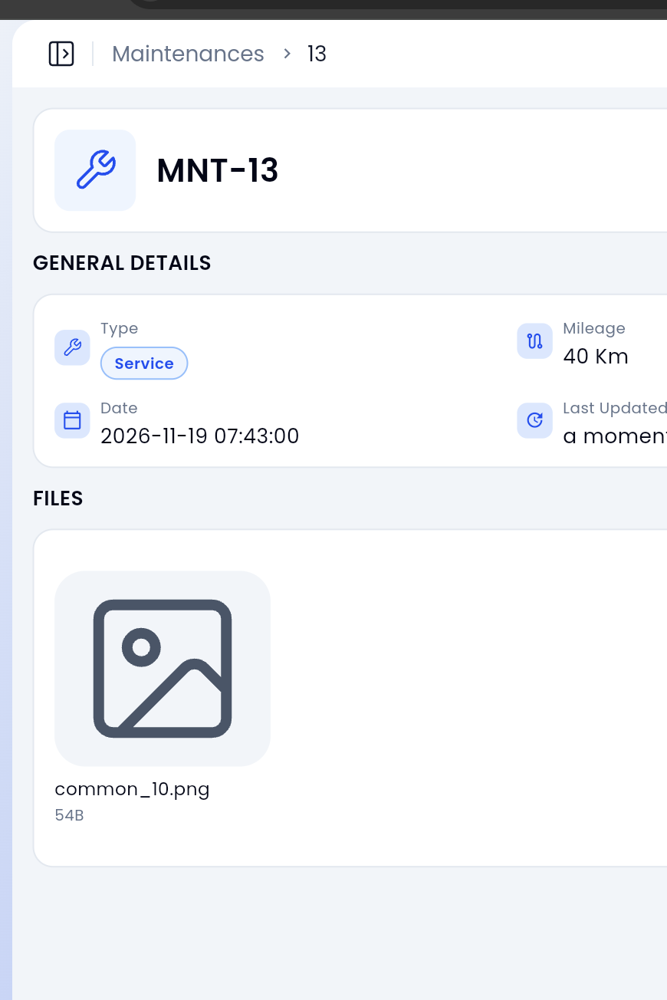
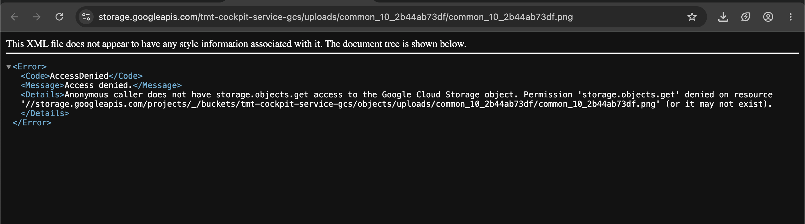
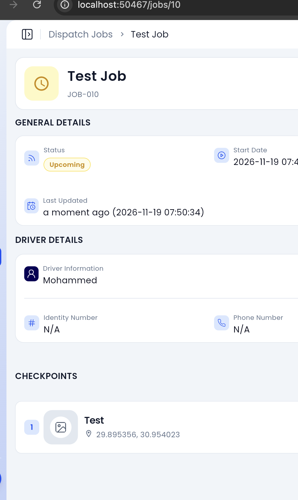
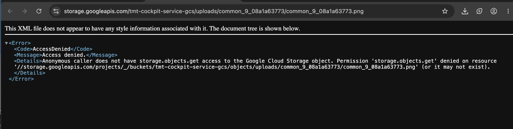

# Staging Bugs

## Madaan Workforce

### 1. GET foreman/me → 404

`https://staging.cockpit.services.tmtx.io/api/madaan/foreman/me`



### 2. POST upload-profile-image → 405

`https://staging.cockpit.services.tmtx.io/api/madaan/foreman/upload-profile-image`



## Rehla Operator

### 1. PUT trips/2 → 400

`https://staging.cockpit.services.tmtx.io/api/rehla/rehla-operator/trips/2`

```text
[PUT] https://staging.cockpit.services.tmtx.io/api/rehla/rehla-operator/trips/2
│ Data: {
│   "data": {
│     "busRoute": 3,
│     "vehicle": 13,
│     "estimatedTripStartTimestamp": "2026-11-18T12:15:00.000Z",
│     "estimatedNextStationArrivalTime": "2026-11-18T12:15:00.000Z",
│     "estimatedFinalDestinationArrivalTime": "2026-11-18T12:19:00.000Z",
│     "totalSeats": 8,
│     "availableSeats": 8,
│     "audience": "ALL",
│     "accessibility": "STANDARD",
│     "waitingTimeOfIntermediate": 4.0,
│     "stationSpecs": [
│       {
│         "station": 1,
│         "sequenceOrder": 1,
│         "platform": "A"
│       },
│       {
│         "station": 1,
│         "sequenceOrder": 2,
│         "platform": "C"
│       }
│     ]
│   }
│ }
│ Headers: {
│   "content-type": "application/json",
│   "authorization": "Bearer [JWT redacted]",
│   "X-Account-Id": "1"
│ }
```

```text
[http-response] [PUT] https://staging.cockpit.services.tmtx.io/api/rehla/rehla-operator/trips/2
│ Status: 400
│ Message: Bad Request
│ Data: {
│   "data": null,
│   "error": {
│     "status": 400,
│     "name": "BadRequestError",
│     "message": "update \"rehla_trip_waitings\" set \"meta\" = $1 where (\"t2\".\"id\" = $2) - missing FROM-clause entry for table \"t2\"",
│     "details": {}
│   }
│ }
```

## TMT GPS

### 1. Maintenance file image → AccessDenied

`https://storage.googleapis.com/tmt-cockpit-service-gcs/uploads/common_10_2b44ab73df/common_10_2b44ab73df.png`





### 2. Dispatch job checkpoint image → AccessDenied

`https://storage.googleapis.com/tmt-cockpit-service-gcs/uploads/common_9_08a1a63773/common_9_08a1a63773.png`





### 3. PUT dispatch-jobs/11 → 400

`https://staging.cockpit.services.tmtx.io/api/dispatch-jobs/11`

```json
{
  "data": {
    "id": 11,
    "name": "Test",
    "vehicle": 14,
    "startTimestamp": "2026-11-19T05:55:00.000Z",
    "dispatchCheckpoints": []
  }
}
```

```text
[http-response] [PUT] https://staging.cockpit.services.tmtx.io/api/dispatch-jobs/11
| Status: 400
| Message:
| Data: {
|   "data": null,
|   "error": {
|     "status": 400,
|     "name": "BadRequestError",
|     "message": "dispatchCheckpoints cannot be set",
|     "details": {}
|   }
| }
```

### 4. DELETE ujrah/client/orders/1 → 405

`https://staging.cockpit.services.tmtx.io/api/ujrah/client/orders/1`

```text
405 Method Not Allowed
Method Not Allowed
```

### 5. DELETE dispatch-jobs/3 → 403

`https://staging.cockpit.services.tmtx.io/api/dispatch-jobs/3`

```json
{
  "data": null,
  "error": {
    "status": 403,
    "name": "ForbiddenError",
    "message": "Forbidden",
    "details": {}
  }
}
```

## All Apps

TMT GPS, Madaan Operator, Rehla Operator, Kold, Nasni, Madaan Workforce

### 1. File larger than 1 MB → request fails (413)

```text
413 Request Entity Too Large
nginx
```
